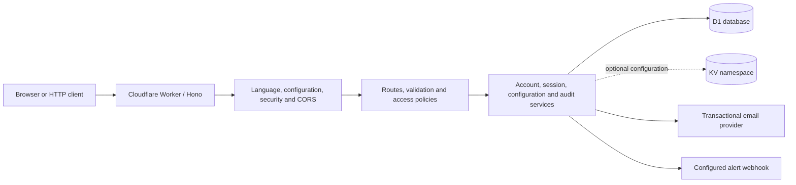

# Hono Auth API Cloudflare Worker

[](https://github.com/dangkhoa2016/Hono-Auth-API-Cloudflare-Worker/actions/workflows/backend-quality.yml?query=branch%3Amain)
[](LICENSE)
[](src/index.js)
[](.nvmrc)

[](documents/WRANGLER_CONFIG_GUIDE.md)
[](migrations/)
[](documents/CAPABILITIES.md)

🌐 Language / Ngôn ngữ: English | [Tiếng Việt](README.vi.md)

Authentication, account administration and audit APIs built with **Hono**, **Cloudflare Workers** and **Cloudflare D1**. The project combines JWT access/refresh sessions, role-based access, localized validation and operational APIs in a JavaScript backend.

Use it with your own HTTP client or the companion [Vue 3 browser application](https://github.com/dangkhoa2016/Vue-3-Browser-Hono-Auth-API-Cloudflare-Worker). The frontend is a separate repository; this Worker owns authentication, permissions, persistent data and server secrets.

[Overview](#overview) · [Architecture](#architecture) · [Quick start](#quick-start) · [API and authentication](#api-and-authentication) · [Configuration](#configuration) · [Vue frontend](#vue-frontend) · [Verification](#verification) · [Deployment](#deployment) · [Troubleshooting](#troubleshooting) · [Documentation](#documentation) · [Contributing](#contributing-and-support) · [License](#license-and-attribution)

## Overview

| Area | What the backend provides |
| --- | --- |
| Accounts | Registration, activation, profile management, password changes and verified email changes. |
| Sessions | JWT access/refresh pairs, refresh rotation, token auditing, logout and account-wide session revocation. |
| Authorization | `user`, `admin` and `super_admin` roles, with route-specific restrictions and data scopes. |
| Validation and language | Zod request schemas and i18next responses, including language selection through `Accept-Language`. |
| Audit | D1 event storage, scoped queries, analytics, archival/restore, retention and bounded CSV/JSON exports. |
| Configuration | Environment settings, optional KV configuration, CORS, rate limits and configurable transactional email. |
| Operations | On-demand monitoring, incident records, recorded response outcomes and console/configured-webhook alerts. |

The [capability contract](documents/CAPABILITIES.md) identifies the exact supported behavior. Monitoring is query-on-demand; continuous monitoring and automatic containment are unavailable. Several incident actions and alert adapters explicitly return unsupported results. CSV/JSON exports are bounded to 10,000 rows/groups; Excel/PDF and advanced rendering options are unsupported. Application features and passing checks do not establish production readiness or compliance certification.

## Architecture



Routes decide whether authentication and administrative permissions are required. Services implement the data and integration contracts; a frontend view or hidden navigation item is not an authorization boundary.

| Component | Technology / source |
| --- | --- |
| Application runtime | Cloudflare Workers; [Hono 4 application](src/index.js) and [route groups](src/routes/routeGroups.js). |
| Persistence | D1 binding `DB`, [append-only migrations](migrations/) and [service layer](src/services/). |
| Authentication | `jsonwebtoken`, `bcryptjs` and [authentication middleware](src/middleware/auth.js). |
| Validation / localization | Zod [schemas](src/schemas/) and [i18next resources](src/i18n/). |
| Local tooling / CI | Node.js 24, npm lockfile, Wrangler, ESLint and the Node test runner. |

Node 24 is the tooling version; deployed requests execute in the Workers runtime. Dependency versions are recorded in [package.json](package.json) and pinned by [package-lock.json](package-lock.json).

## Quick start

### 1. Prepare the workspace

Install Git, Node.js **24** and npm. With nvm available:

```bash
git clone https://github.com/dangkhoa2016/Hono-Auth-API-Cloudflare-Worker.git
cd Hono-Auth-API-Cloudflare-Worker
nvm install 24
nvm use 24
npm ci --ignore-scripts --no-audit --no-fund
cp wrangler.toml.example wrangler.toml
cp .dev.vars.development.example .dev.vars.development
```

Local development uses local D1 storage and the development placeholders in the template; a remote database ID is unnecessary for this path. Keep `wrangler.toml` and `.dev.vars.*` out of version control.

### 2. Configure the local environment

Generate a secret locally:

```bash
node -e "console.log(require('node:crypto').randomBytes(32).toString('hex'))"
```

Put the generated value in `.dev.vars.development`. A minimal configuration is:

```toml
JWT_SECRET = "replace-with-the-generated-value"
ENV = "development"
DEBUG = ""
ENABLE_DETAILED_ERRORS = "false"
EMAIL_ENABLED = "false"
```

Use a distinct secret for each environment. The example disables email and broad debug output; add provider settings only when testing email delivery. For a separately served browser client, set `CORS_ORIGIN` to its actual origin.

### 3. Apply migrations and start the Worker

```bash
npm run db:migrate
npm run dev
```

The development API listens at **http://localhost:8787** and persists local state under `.wrangler/`. In another terminal:

```bash
curl http://localhost:8787/
curl http://localhost:8787/health
```

The root reports API information; `/health` is a health response, not an end-to-end check of every dependency. For a separate local test server, use `npm run db:migrate:test` and `npm run dev:test` with `.dev.vars.test`; its port is `8788`.

### 4. Choose an account flow

Accounts live in the selected D1 database. By default, newly registered accounts need activation. Disabling email does not activate an account; use a configured activation flow, an authorized administrator or, only for disposable local development, `AUTO_ACTIVATE_USER_ON_REGISTER = "true"`.

The historical [initial migration](migrations/0001_initial.sql) inserts a bootstrap account, and [migration 0002](migrations/0002_add_role_column.sql) promotes user ID 1. These are source-visible bootstrap data, not private production credentials. Review and secure bootstrap accounts and sample records before exposing a remote deployment.

`npm run setup:dev` and `npm run setup:test` also execute [fixture reset SQL](tests/init/reset.sql), which deletes/reseeds local data. They are not required for the manual quick start. Never run fixture resets against staging or production. The [password-reset CLI](tools/database/reset_superadmin_user_password.js) supports selected local super-admin accounts only; inspect `--help` before use.

See the [setup guide](documents/SETUP_GUIDE.md) for storage, secrets, optional KV and fixture details.

## API and authentication

### Session flow

1. Register through `POST /api/user/register` or use an account provisioned for the selected backend. Complete activation when required.
2. Send account credentials to `POST /api/auth/login`. A successful response contains `data.access_token`, `data.refresh_token`, expiration fields and user information.
3. Send `Authorization: Bearer <access_token>` to protected routes such as `GET /api/user/profile` or `GET /api`.
4. Refresh through `POST /api/auth/refresh_token` with the current `refresh_token`. Save **both** replacement tokens and coordinate concurrent refresh attempts.
5. `POST /api/auth/logout` revokes the selected refresh session and blacklists the current access token. `POST /api/auth/logout-all` revokes the user's sessions. Both require the bearer token and a JSON `refresh_token`.

Example login request; replace the illustrative credentials with your own account:

```http
POST /api/auth/login HTTP/1.1
Host: localhost:8787
Content-Type: application/json
Accept-Language: en

{"email":"your-account@example.com","password":"your-account-password"}
```

Refresh request body:

```json
{"refresh_token":"current-refresh-token"}
```

Treat 401 as an authentication/session outcome and handle 429 using the returned retry information. Do not automatically replay a mutation after an ambiguous timeout. Client/session compatibility and `AUTH_VERSION_ENFORCEMENT` rollout are described in the [upgrade guide](documents/UPGRADE_RELEASE.md).

### Route map

| Route | Purpose / access |
| --- | --- |
| `GET /`, `GET /health`, `GET /version` | Public API information, health and version. |
| `GET /api` | Authenticated endpoint discovery, filtered for the user's role. |
| `POST /api/user/register`, `GET /api/auth/activate` | Registration and account activation. |
| `POST /api/auth/login`, `POST /api/auth/refresh_token` | Credential login and refresh-token rotation. |
| `POST /api/auth/logout`, `POST /api/auth/logout-all` | Authenticated session revocation. |
| `/api/user/*` | Profile, password and email-change operations; access depends on the route. |
| `POST /api/admin/users/:id/reset-password` | Reset a lower-role account password, revoke all its sessions and record an audit in one transaction. [Guide](documents/ADMIN_PASSWORD_RESET.md). |
| `/api/admin/*` | User/role administration, token blacklist and token audit under administrative policies. |
| `/api/kv-admin/*` | Administrative configuration operations requiring the optional KV binding. |
| `/api/audit/*`, `/api/advanced-audit/*` | Scoped audit operations, analytics, archive/retention and exports. |
| `/api/realtime-monitoring/*`, `/api/security-incident/*` | On-demand monitoring, alert and incident APIs with explicit capability limits. |

This is an orientation map. Use authenticated `GET /api`, the [route source](src/routes/) and the [capability matrix](documents/CAPABILITIES.md) for operation-specific roles, payloads and limits. In particular, an admin role does not imply unrestricted access to every user or audit record.

## Configuration

| File / binding / setting | Purpose |
| --- | --- |
| `wrangler.toml` | Ignored operator configuration: Worker names, D1/asset bindings and environment selectors; start from [the template](wrangler.toml.example). |
| `.dev.vars.development`, `.dev.vars.test` | Ignored local secrets/settings, based on their committed examples. |
| `DB` | Required D1 binding; apply migrations `0001` through `0012`. |
| `CONFIG_KV` | Optional configuration storage. Ordinary reads can use environment/default values; KV administration requires a binding. |
| `ENV` | Application environment (`development`, `test`, `staging`, `production`); set it explicitly for each deployment target. |
| `JWT_SECRET` | Token signing secret, unique per environment. Use deployed secret storage for remote Workers. |
| `CORS_ORIGIN` | Allowed browser origins, for example `http://localhost:4173`; use the actual deployed frontend origin remotely. |
| `APP_URL`, `EMAIL_ENABLED` | Account-email links and email policy; delivery additionally needs provider configuration. |
| `AUTO_ACTIVATE_USER_ON_REGISTER` | Registration policy; default is activation required. Do not carry a local bypass into production unintentionally. |
| `DEBUG`, `ENABLE_DETAILED_ERRORS` | Diagnostics; keep broad logging and detailed errors disabled outside focused troubleshooting. |

The [complete variables example](.dev.vars.complete.example) inventories settings; the [Wrangler guide](documents/WRANGLER_CONFIG_GUIDE.md) explains how to apply them. A local `.dev.vars.*` file does **not** provision deployed secrets. Named environments need their own bindings; do not assume root bindings are inherited.

## Vue frontend

The [companion frontend](https://github.com/dangkhoa2016/Vue-3-Browser-Hono-Auth-API-Cloudflare-Worker) provides browser views for accounts, API discovery and administration. Its backend selection and mock mode are separate from Worker configuration.

- In the frontend's **Settings** page (`/#/settings`), select the real backend's base URL. Endpoint definitions already include `/api/...`; do not add another `/api` suffix to the base URL.
- Select real API mode and sign in with an account from that backend's D1 database. Frontend JSON fixtures do not provision deployed accounts.
- Add the browser origin to `CORS_ORIGIN` and allow the headers used by the client, including `Authorization` and, when used, `Accept-Language`.
- Keep JWT/provider secrets in the Worker. The browser receives session tokens and public configuration only.

Follow the frontend repository's local launcher instructions when using its backend proxy.

## Verification

The canonical command matches [Backend quality CI](.github/workflows/backend-quality.yml):

```bash
npm run verify
```

| Command | What it checks |
| --- | --- |
| `npm run lint:check` | Application/test ESLint rules, with zero warnings allowed. |
| `npm run lint:tools` | Supported password-reset command/helper and documentation-checker lint. |
| `npm run verify:docs` | Relative file targets and package-script references in README/documentation. |
| `npm run test:node` | Canonical regression/integration discovery, including disposable local D1, migration and Worker checks. |
| `npm run test:regression` | Focused regression suites. |

The canonical checks need no remote account secrets. Historical live-server and interactive suites are separate; `npm test` launches a menu and prepares local fixtures. A local pass does not verify provider delivery, production resources, throughput or every legacy tool. See the [verification guide](documents/TEST_GUIDE.md) and [command reference](documents/TEST_SCRIPTS.md).

## Deployment

Before publishing, configure the Cloudflare account, the selected Worker's D1/bindings, independent secrets, allowed origins and account/email policies. Review migration bootstrap/sample data, secure initial accounts and rehearse schema/session compatibility in staging. Keep rate limiting enabled unless testing a deliberately isolated scenario.

| Target | Migration command | Deploy command |
| --- | --- | --- |
| Staging (`--env staging`) | `npm run db:migrate:staging` | `npm run deploy:staging` |
| Production (default environment) | `npm run db:migrate:prod` | `npm run deploy:prod` |

Set the application's environment explicitly in the corresponding Wrangler variables (merge these settings into your operator configuration):

```toml
[vars]
ENV = "production"

[env.staging.vars]
ENV = "staging"
```

Wrangler's target selector does not populate application `ENV`. When neither `ENV` nor `ENVIRONMENT` is configured, the application falls back to `development`, which also affects environment-specific security behavior.

These commands change remote resources. Set JWT through `npm run secret:put:staging` or `npm run secret:put:prod`, and provision other provider secrets for the same target. Production is the **default** Wrangler environment. `dev:staging` uses remote resources and is not an isolated local test server.

Apply the complete migration sequence before code that requires it. In particular, `0011` preserves archive metadata and `0012` adds session revocation fields. Keep a recovery plan; additive migrations do not supply an automatic schema rollback.

Verify health, login/rotated refresh pairs, permissions, revocation, audit/export and configured integrations after deployment. Record the commit, environment, migration state, deployment identifier and actual results. Follow the full [upgrade and release checklist](documents/UPGRADE_RELEASE.md).

## Troubleshooting

| Symptom | First checks |
| --- | --- |
| Worker starts but requests fail with `WeakRef` errors | Use the template's `2025-06-01` compatibility date and `nodejs_compat` flag. |
| Missing D1 table/column | Confirm the selected environment and apply all migrations through `0012`. |
| Login is rejected / protected route returns 401 | Check the selected backend, account status, token expiry and session revocation; send the access bearer token. |
| Browser requests fail at CORS | Match the frontend's actual origin and required headers to the backend configuration. |
| Registration succeeds but no activation email arrives | Inspect `email_notification`, activation policy, email enablement and provider configuration. Registration success alone does not confirm delivery. |
| An operation returns 422 with an unsupported code | Check the capability contract; enabling a flag does not implement a missing adapter. |
| Archive statistics return 503 `ARCHIVE_STATS_TIMEOUT` | Preserve the request ID and investigate availability; do not replace the failure with zero statistics. |

## Documentation

| Topic | English | Tiếng Việt |
| --- | --- | --- |
| Supported behavior and limits | [Capabilities](documents/CAPABILITIES.md) | [Khả năng](documents/CAPABILITIES.vi.md) |
| Local development | [Setup](documents/SETUP_GUIDE.md) | [Cài đặt](documents/SETUP_GUIDE.vi.md) |
| Environments and secrets | [Wrangler](documents/WRANGLER_CONFIG_GUIDE.md) | [Wrangler](documents/WRANGLER_CONFIG_GUIDE.vi.md) |
| Maintained checks | [Verification](documents/TEST_GUIDE.md) | [Kiểm chứng](documents/TEST_GUIDE.vi.md) |
| Test commands | [Scripts](documents/TEST_SCRIPTS.md) | [Lệnh kiểm thử](documents/TEST_SCRIPTS.vi.md) |
| Migrations, rollout and provenance | [Upgrade/release](documents/UPGRADE_RELEASE.md) | [Nâng cấp/phát hành](documents/UPGRADE_RELEASE.vi.md) |
| Audit overview | [Audit](documents/ENTERPRISE_AUDIT_SYSTEM_COMPLETE_GUIDE.md) | [Kiểm toán](documents/ENTERPRISE_AUDIT_SYSTEM_COMPLETE_GUIDE.vi.md) |

Additional [topic references](documents/) cover roles, schemas, i18n, email and storage. Retained historical guides are labeled; old examples or readiness/coverage claims are not current operational guarantees. The history contains an imported baseline and curated commits with retained author dates; see the release guide for provenance and evidence boundaries.

## Repository layout

```text
.github/         CI, contribution policies and issue/PR templates
src/
  index.js       Worker entry point
  routes/        API handlers and route groups
  middleware/    Authentication, authorization, security and request processing
  services/      Accounts, sessions, configuration and audit implementations
  schemas/       Zod request schemas and validation registry
  i18n/          Language resources and localization services
  assets/        Project icons
migrations/      Ordered D1 schema/data migrations
tests/           Regression, integration, fixtures and optional server suites
tools/           Documentation and maintenance utilities
```

## Contributing and support

Read [CONTRIBUTING.md](.github/CONTRIBUTING.md) before proposing a change. Use the [issue forms](https://github.com/dangkhoa2016/Hono-Auth-API-Cloudflare-Worker/issues/new/choose) for reproducible bugs or feature requests, and include the revision, environment, minimal steps and redacted output.

Follow [SUPPORT.md](.github/SUPPORT.md) for questions, [SECURITY.md](.github/SECURITY.md) for private vulnerability reporting, and the [Code of Conduct](.github/CODE_OF_CONDUCT.md) when participating. English and Vietnamese contributions are welcome.

## License and attribution

Source code is available under the [MIT License](LICENSE), copyright **2026 Đăng Khoa <i.am@dangkhoa.dev>**.

The icons `src/assets/favicon.ico`, `src/assets/favicon.png` and `src/assets/icon-192.png` come from the [Microchip icon on Magnific](https://www.magnific.com/icon/microchip_5776925), by [jansenwebconcepts](https://www.magnific.com/author/jansenwebconcepts). Their separate attribution and license notice remain in [LICENSE-ICONS.md](LICENSE-ICONS.md).
