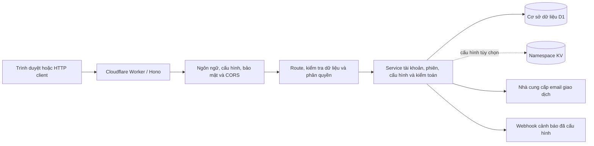

# Hono Auth API Cloudflare Worker

[](https://github.com/dangkhoa2016/Hono-Auth-API-Cloudflare-Worker/actions/workflows/backend-quality.yml?query=branch%3Amain)
[](LICENSE)
[](src/index.js)
[](.nvmrc)

[](documents/WRANGLER_CONFIG_GUIDE.vi.md)
[](migrations/)
[](documents/CAPABILITIES.vi.md)

🌐 Language / Ngôn ngữ: [English](README.md) | Tiếng Việt

API xác thực, quản trị tài khoản và kiểm toán dùng **Hono**, **Cloudflare Workers** và **Cloudflare D1**. Backend JavaScript này kết hợp phiên JWT access/refresh, phân quyền theo vai trò, kiểm tra dữ liệu đa ngôn ngữ và các API vận hành.

Bạn có thể dùng HTTP client riêng hoặc [ứng dụng trình duyệt Vue 3](https://github.com/dangkhoa2016/Vue-3-Browser-Hono-Auth-API-Cloudflare-Worker) đi kèm. Frontend nằm ở repository riêng; Worker chịu trách nhiệm xác thực, phân quyền, dữ liệu lưu trữ và secret phía server.

[Tổng quan](#tổng-quan) · [Tính năng](#tính-năng) · [Kiến trúc](#kiến-trúc) · [Khởi động nhanh](#khởi-động-nhanh) · [API và xác thực](#api-và-xác-thực) · [Cấu hình](#cấu-hình) · [Frontend Vue](#frontend-vue) · [Kiểm chứng](#kiểm-chứng) · [Triển khai](#triển-khai) · [Xử lý sự cố](#xử-lý-sự-cố) · [Tài liệu](#tài-liệu) · [Đóng góp](#đóng-góp-và-hỗ-trợ) · [Giấy phép](#giấy-phép-và-ghi-công)

## Tổng quan

| Nhóm chức năng | Backend cung cấp |
| --- | --- |
| Tài khoản | Đăng ký, kích hoạt, quản lý hồ sơ, đổi mật khẩu và xác minh đổi email. |
| Phiên đăng nhập | Cặp JWT access/refresh, xoay refresh token, kiểm toán token, đăng xuất và thu hồi phiên trên toàn tài khoản. |
| Phân quyền | Vai trò `user`, `admin`, `super_admin`, với hạn chế và phạm vi dữ liệu theo từng route. |
| Kiểm tra dữ liệu và ngôn ngữ | Schema Zod và phản hồi i18next, có chọn ngôn ngữ qua `Accept-Language`. |
| Kiểm toán | Lưu sự kiện trong D1, truy vấn có phạm vi, phân tích, lưu trữ/khôi phục, chính sách lưu giữ và xuất CSV/JSON có giới hạn. |
| Cấu hình | Biến môi trường, cấu hình KV tùy chọn, CORS, giới hạn tần suất và email giao dịch có cấu hình. |
| Vận hành | Monitoring theo truy vấn, hồ sơ sự cố, ghi nhận kết quả phản ứng và cảnh báo qua console/webhook đã cấu hình. |

[Tài liệu khả năng](documents/CAPABILITIES.vi.md) xác định hành vi được hỗ trợ. Monitoring hoạt động theo truy vấn; chưa có monitoring liên tục hoặc tự động ngăn chặn sự cố. Một số action và adapter cảnh báo trả rõ kết quả chưa hỗ trợ. Xuất CSV/JSON giới hạn 10.000 dòng/nhóm; chưa hỗ trợ Excel/PDF và tùy chọn dựng báo cáo nâng cao. Tính năng và kết quả kiểm tra thành công không tự chứng minh hệ thống sẵn sàng production hay đạt chứng nhận tuân thủ.

## Tính năng

- **Đầy đủ luồng quản lý tài khoản.** Đăng ký và kích hoạt tài khoản, quản lý hồ sơ, đổi mật khẩu và xác minh đổi email. Mật khẩu được băm bằng bcrypt; kích hoạt và gửi email tuân theo chính sách tài khoản đã cấu hình.
- **Phiên JWT có thể thu hồi.** Cặp access/refresh token, xoay refresh token, đăng xuất từng phiên và thu hồi trên toàn tài khoản hỗ trợ kiểm soát đăng nhập nhiều thiết bị. Server kiểm tra trạng thái bảo mật trực tiếp từ database theo chính sách phiên bản phiên đã cấu hình trước khi dùng dữ liệu danh tính trong cache. Xem [hợp đồng phiên và nâng cấp](documents/UPGRADE_RELEASE.vi.md).
- **Quản trị tài khoản theo vai trò.** Quản lý người dùng, vai trò và trạng thái tài khoản bằng chính sách phía server cho `user`, `admin`, `super_admin`. Xóa tài khoản xử lý dữ liệu phiên phụ thuộc trong cùng giao dịch và giữ lại thông tin kiểm toán lịch sử.
- **Đặt lại mật khẩu nguyên tử bởi quản trị viên.** Admin reset tài khoản User; Super Admin reset User/Admin. Hash mật khẩu mới, tăng phiên bản phiên, thu hồi refresh token và sự kiện audit được ghi trong cùng giao dịch. Không cho reset chính mình, tài khoản ngang quyền hoặc cao hơn. Xem [hướng dẫn đặt lại mật khẩu](documents/ADMIN_PASSWORD_RESET.vi.md).
- **Lịch sử kiểm toán có phân quyền.** Lưu sự kiện trong D1, tìm kiếm và lọc theo phạm vi dữ liệu của từng vai trò, xem phân tích và quản lý lưu trữ/khôi phục cùng chính sách lưu giữ. Luồng ghi audit áp dụng che dữ liệu xác thực. Xem [tài liệu API kiểm toán](documents/AUDIT_API_REFERENCE.vi.md).
- **Xuất CSV/JSON có giới hạn.** Xuất dữ liệu audit với tối đa 10.000 dòng/nhóm, phép tổng hợp trong danh sách hỗ trợ và bảo vệ chống công thức CSV. Định dạng hoặc tùy chọn dựng báo cáo chưa hỗ trợ trả lỗi rõ ràng thay vì báo thành công sai.
- **Kiểm tra dữ liệu và phản hồi đa ngôn ngữ.** Schema Zod tập trung kiểm tra đầu vào API; i18next cung cấp phản hồi bằng tiếng Anh, Việt, Pháp, Tây Ban Nha, Đức, Nhật và Thái, có chọn ngôn ngữ qua `Accept-Language`.
- **Cấu hình và lưu trữ trên Cloudflare.** Migration D1 định nghĩa dữ liệu lưu trữ; Workers KV tùy chọn cung cấp cấu hình quản trị. Thiết lập CORS, giới hạn tần suất, token và email giao dịch riêng cho từng môi trường. Xem [hướng dẫn cấu hình Wrangler](documents/WRANGLER_CONFIG_GUIDE.vi.md).
- **Thông tin vận hành với kết quả rõ ràng.** Endpoint sức khỏe/phiên bản công khai, dashboard quản trị, monitoring theo truy vấn và hồ sơ vòng đời sự cố hỗ trợ chẩn đoán. Cảnh báo webhook đã cấu hình ghi nhận kết quả gửi; [tài liệu khả năng](documents/CAPABILITIES.vi.md) phân biệt thao tác đã triển khai với adapter chưa khả dụng.
- **Kiểm chứng local có thể tái lập.** Dependency npm được khóa phiên bản, kiểm tra ESLint, kiểm tra tài liệu và test Node chạy qua `npm run verify`. Test tích hợp D1/workerd kiểm tra migration, phân quyền, phiên đồng thời và rollback giao dịch. Xem [hướng dẫn kiểm chứng](documents/TEST_GUIDE.vi.md).

## Kiến trúc



Route quyết định yêu cầu xác thực và quyền quản trị. Service thực thi hợp đồng dữ liệu và tích hợp; giao diện frontend hoặc việc ẩn mục điều hướng không thay thế phân quyền ở server.

| Thành phần | Công nghệ / mã nguồn |
| --- | --- |
| Môi trường chạy ứng dụng | Cloudflare Workers; [ứng dụng Hono 4](src/index.js) và [nhóm route](src/routes/routeGroups.js). |
| Lưu trữ | Binding D1 `DB`, [migration chỉ bổ sung](migrations/) và [tầng service](src/services/). |
| Xác thực | `jsonwebtoken`, `bcryptjs` và [middleware xác thực](src/middleware/auth.js). |
| Kiểm tra dữ liệu / bản địa hóa | [Schema Zod](src/schemas/) và [tài nguyên i18next](src/i18n/). |
| Công cụ local / CI | Node.js 24, npm lockfile, Wrangler, ESLint và trình chạy test của Node. |

Node 24 là phiên bản cho công cụ; request đã triển khai chạy trong Workers runtime. [package.json](package.json) ghi khai báo dependency, còn [package-lock.json](package-lock.json) ghim phiên bản cài đặt.

## Khởi động nhanh

### 1. Chuẩn bị workspace

Cài Git, Node.js **24** và npm. Khi đã có nvm:

```bash
git clone https://github.com/dangkhoa2016/Hono-Auth-API-Cloudflare-Worker.git
cd Hono-Auth-API-Cloudflare-Worker
nvm install 24
nvm use 24
npm ci --ignore-scripts --no-audit --no-fund
cp wrangler.toml.example wrangler.toml
cp .dev.vars.development.example .dev.vars.development
```

Phát triển local dùng D1 cục bộ và placeholder development trong template; quy trình này không cần ID database từ xa. Không đưa `wrangler.toml` và `.dev.vars.*` vào Git.

### 2. Cấu hình môi trường local

Tạo secret trên máy local:

```bash
node -e "console.log(require('node:crypto').randomBytes(32).toString('hex'))"
```

Đặt giá trị vừa tạo vào `.dev.vars.development`. Cấu hình tối thiểu:

```toml
JWT_SECRET = "replace-with-the-generated-value"
ENV = "development"
DEBUG = ""
ENABLE_DETAILED_ERRORS = "false"
EMAIL_ENABLED = "false"
```

Dùng secret riêng cho từng môi trường. Ví dụ tắt email và log debug diện rộng; chỉ bổ sung thông tin nhà cung cấp khi thử gửi email. Nếu phục vụ browser client riêng, đặt `CORS_ORIGIN` theo origin thực tế của client.

### 3. Áp dụng migration và chạy Worker

```bash
npm run db:migrate
npm run dev
```

API development chạy tại **http://localhost:8787**, lưu state local trong `.wrangler/`. Mở terminal khác:

```bash
curl http://localhost:8787/
curl http://localhost:8787/health
```

Route `/` trả thông tin API; `/health` là phản hồi sức khỏe, không kiểm chứng toàn bộ dependency từ đầu đến cuối. Để chạy server test local riêng, dùng `npm run db:migrate:test` và `npm run dev:test` với `.dev.vars.test`; cổng là `8788`.

### 4. Chọn luồng tài khoản

Tài khoản nằm trong D1 của backend được chọn. Mặc định tài khoản đăng ký mới cần kích hoạt. Tắt email không làm tài khoản tự kích hoạt; hãy dùng luồng kích hoạt đã cấu hình, quản trị viên có quyền hoặc, chỉ với môi trường local dùng thử, `AUTO_ACTIVATE_USER_ON_REGISTER = "true"`.

[Migration đầu tiên](migrations/0001_initial.sql) có tài khoản bootstrap, và [migration 0002](migrations/0002_add_role_column.sql) cấp vai trò quản trị cao nhất cho user ID 1. Đây là dữ liệu bootstrap công khai trong source, không phải thông tin đăng nhập production riêng tư. Kiểm tra và bảo vệ tài khoản bootstrap cùng dữ liệu mẫu trước khi mở deployment từ xa cho người dùng.

`npm run setup:dev` và `npm run setup:test` còn thực thi [SQL reset fixture](tests/init/reset.sql), xóa/nạp lại dữ liệu local. Hai lệnh này không bắt buộc trong quy trình thủ công ở trên. Không chạy reset fixture với staging hoặc production. [CLI reset mật khẩu](tools/database/reset_superadmin_user_password.js) chỉ hỗ trợ tài khoản super-admin local được chỉ định; xem `--help` trước khi dùng.

Xem [hướng dẫn cài đặt](documents/SETUP_GUIDE.vi.md) để biết chi tiết storage, secret, KV tùy chọn và fixture.

## API và xác thực

### Luồng phiên đăng nhập

1. Đăng ký qua `POST /api/user/register` hoặc dùng tài khoản đã được tạo cho backend đang chọn. Hoàn tất kích hoạt nếu được yêu cầu.
2. Gửi thông tin tài khoản đến `POST /api/auth/login`. Phản hồi thành công có `data.access_token`, `data.refresh_token`, thông tin hết hạn và người dùng.
3. Gửi `Authorization: Bearer <access_token>` khi gọi route cần xác thực, như `GET /api/user/profile` hoặc `GET /api`.
4. Refresh qua `POST /api/auth/refresh_token` với `refresh_token` hiện tại. Lưu **cả hai** token thay thế và phối hợp các lần refresh đồng thời.
5. `POST /api/auth/logout` thu hồi phiên refresh được chọn và chặn access token hiện tại. `POST /api/auth/logout-all` thu hồi các phiên của tài khoản. Cả hai cần bearer token và JSON có `refresh_token`.

Ví dụ request đăng nhập; thay thông tin minh họa bằng tài khoản của bạn:

```http
POST /api/auth/login HTTP/1.1
Host: localhost:8787
Content-Type: application/json
Accept-Language: vi

{"email":"your-account@example.com","password":"your-account-password"}
```

JSON body cho refresh:

```json
{"refresh_token":"current-refresh-token"}
```

Xử lý 401 theo trạng thái xác thực/phiên, và 429 theo thông tin thời gian thử lại được trả về. Không tự động gửi lại request thay đổi dữ liệu khi timeout chưa rõ kết quả. [Hướng dẫn nâng cấp](documents/UPGRADE_RELEASE.vi.md) mô tả tương thích client/phiên và lộ trình áp dụng `AUTH_VERSION_ENFORCEMENT`.

### Bản đồ route

| Route | Mục đích / quyền truy cập |
| --- | --- |
| `GET /`, `GET /health`, `GET /version` | Thông tin API, sức khỏe và phiên bản công khai. |
| `GET /api` | Khám phá endpoint sau đăng nhập, lọc theo vai trò. |
| `POST /api/user/register`, `GET /api/auth/activate` | Đăng ký và kích hoạt tài khoản. |
| `POST /api/auth/login`, `POST /api/auth/refresh_token` | Đăng nhập bằng thông tin tài khoản và xoay refresh token. |
| `POST /api/auth/logout`, `POST /api/auth/logout-all` | Thu hồi phiên sau xác thực. |
| `/api/user/*` | Hồ sơ, mật khẩu và đổi email; quyền phụ thuộc route. |
| `POST /api/admin/users/:id/reset-password` | Đặt lại mật khẩu tài khoản có quyền thấp hơn, thu hồi mọi phiên và ghi audit trong cùng giao dịch. [Hướng dẫn](documents/ADMIN_PASSWORD_RESET.vi.md). |
| `/api/admin/*` | Quản trị tài khoản/vai trò, danh sách chặn token và kiểm toán token theo chính sách quản trị. |
| `/api/kv-admin/*` | Quản trị cấu hình, cần binding KV tùy chọn. |
| `/api/audit/*`, `/api/advanced-audit/*` | Kiểm toán có phạm vi, phân tích, lưu trữ/chính sách lưu giữ và xuất dữ liệu. |
| `/api/realtime-monitoring/*`, `/api/security-incident/*` | API monitoring theo truy vấn, cảnh báo và sự cố với giới hạn khả năng rõ ràng. |

Bảng này giúp định hướng. Dùng `GET /api` sau đăng nhập, [source route](src/routes/) và [ma trận khả năng](documents/CAPABILITIES.vi.md) để kiểm tra vai trò, payload và giới hạn của từng thao tác. Vai trò admin không đồng nghĩa với quyền không giới hạn trên mọi tài khoản hay bản ghi kiểm toán.

## Cấu hình

| File / binding / thiết lập | Mục đích |
| --- | --- |
| `wrangler.toml` | Cấu hình riêng không commit: tên Worker, binding D1/asset và lựa chọn môi trường; bắt đầu từ [template](wrangler.toml.example). |
| `.dev.vars.development`, `.dev.vars.test` | Secret/thiết lập local không commit, tạo từ file mẫu tương ứng. |
| `DB` | Binding D1 bắt buộc; áp dụng migration `0001` đến `0012`. |
| `CONFIG_KV` | Lưu cấu hình tùy chọn. Đọc thông thường có thể dùng env/default; quản trị KV cần binding. |
| `ENV` | Môi trường ứng dụng (`development`, `test`, `staging`, `production`); đặt rõ cho từng đích triển khai. |
| `JWT_SECRET` | Secret ký token riêng cho từng môi trường. Worker từ xa dùng kho secret đã triển khai. |
| `CORS_ORIGIN` | Origin trình duyệt được phép, ví dụ `http://localhost:4173`; môi trường từ xa dùng origin frontend đã triển khai thực tế. |
| `APP_URL`, `EMAIL_ENABLED` | Link email tài khoản và chính sách email; gửi thư còn cần cấu hình nhà cung cấp. |
| `AUTO_ACTIVATE_USER_ON_REGISTER` | Chính sách đăng ký; mặc định cần kích hoạt. Không vô tình mang cơ chế bỏ qua local sang production. |
| `DEBUG`, `ENABLE_DETAILED_ERRORS` | Chẩn đoán; tắt log diện rộng và lỗi chi tiết ngoài lúc điều tra cụ thể. |

[Ví dụ biến đầy đủ](.dev.vars.complete.example) liệt kê các thiết lập; [hướng dẫn Wrangler](documents/WRANGLER_CONFIG_GUIDE.vi.md) giải thích cách áp dụng. File `.dev.vars.*` local **không** tự tạo secret trên Worker đã triển khai. Mỗi môi trường có tên cần binding riêng; không mặc định binding root được kế thừa.

## Frontend Vue

[Frontend đi kèm](https://github.com/dangkhoa2016/Vue-3-Browser-Hono-Auth-API-Cloudflare-Worker) cung cấp giao diện tài khoản, khám phá API và quản trị. Việc chọn backend và chế độ mock tách biệt với cấu hình Worker.

- Tại trang **Settings** (`/#/settings`) của frontend, chọn base URL của backend thật. Khai báo endpoint đã chứa `/api/...`; không thêm hậu tố `/api` vào base URL.
- Chọn chế độ API thật và đăng nhập bằng tài khoản trong D1 của backend đó. JSON fixture frontend không tạo tài khoản trên dịch vụ đã triển khai.
- Thêm origin trình duyệt vào `CORS_ORIGIN` và cho phép header mà client dùng, gồm `Authorization` và `Accept-Language` khi sử dụng.
- Giữ JWT/provider secret trong Worker. Trình duyệt chỉ nhận token phiên và cấu hình công khai.

Khi dùng proxy backend của frontend, làm theo hướng dẫn launcher local trong repository frontend.

## Kiểm chứng

Lệnh chuẩn khớp [CI Backend quality](.github/workflows/backend-quality.yml):

```bash
npm run verify
```

| Lệnh | Nội dung kiểm tra |
| --- | --- |
| `npm run lint:check` | ESLint ứng dụng/test, không cho phép warning. |
| `npm run lint:tools` | Lint command/helper reset mật khẩu được hỗ trợ và công cụ kiểm tra tài liệu. |
| `npm run verify:docs` | Đích file tương đối và tham chiếu package script trong README/tài liệu. |
| `npm run test:node` | Bộ regression/integration chuẩn, gồm D1 tạm thời, migration và Worker local. |
| `npm run test:regression` | Các suite regression để kiểm tra tập trung. |

Các kiểm tra chuẩn không cần secret tài khoản từ xa. Suite server trực tiếp và suite tương tác cũ chạy riêng; `npm test` mở menu và chuẩn bị fixture local. Kết quả local không xác minh việc giao thư, tài nguyên production, thông lượng hay mọi tool cũ. Xem [hướng dẫn kiểm chứng](documents/TEST_GUIDE.vi.md) và [tham khảo lệnh](documents/TEST_SCRIPTS.vi.md).

## Triển khai

Trước khi publish, cấu hình account Cloudflare, D1/binding của đúng Worker, secret độc lập, origin được phép và chính sách tài khoản/email. Kiểm tra dữ liệu bootstrap/mẫu trong migration, bảo vệ tài khoản ban đầu và diễn tập tương thích schema/phiên ở staging. Giữ giới hạn tần suất trừ khi thử một tình huống đã cô lập rõ ràng.

| Đích | Lệnh migration | Lệnh deploy |
| --- | --- | --- |
| Staging (`--env staging`) | `npm run db:migrate:staging` | `npm run deploy:staging` |
| Production (môi trường mặc định) | `npm run db:migrate:prod` | `npm run deploy:prod` |

Đặt rõ môi trường ứng dụng trong phần biến Wrangler tương ứng (gộp các thiết lập này vào cấu hình riêng của bạn):

```toml
[vars]
ENV = "production"

[env.staging.vars]
ENV = "staging"
```

Lựa chọn đích Wrangler không tự điền `ENV` của ứng dụng. Khi cả `ENV` lẫn `ENVIRONMENT` chưa được cấu hình, ứng dụng dùng mặc định `development`, ảnh hưởng cả hành vi bảo mật theo môi trường.

Các lệnh này thay đổi tài nguyên từ xa. Đặt JWT qua `npm run secret:put:staging` hoặc `npm run secret:put:prod`, và tạo các provider secret khác cho cùng đích. Production là môi trường Wrangler **mặc định**. `dev:staging` dùng tài nguyên từ xa, không phải server test local cô lập.

Áp dụng đầy đủ migration trước khi chạy code phụ thuộc vào schema mới. Đặc biệt, `0011` giữ metadata archive, `0012` thêm trường thu hồi phiên. Chuẩn bị phương án khôi phục; migration bổ sung không tự cung cấp rollback schema.

Sau deploy, kiểm tra health, đăng nhập/refresh với cặp token đã xoay, phân quyền, thu hồi phiên, kiểm toán/xuất dữ liệu và tích hợp đã cấu hình. Ghi lại commit, môi trường, trạng thái migration, ID deployment và kết quả thực tế. Làm theo [checklist nâng cấp và phát hành](documents/UPGRADE_RELEASE.vi.md) đầy đủ.

## Xử lý sự cố

| Hiện tượng | Kiểm tra đầu tiên |
| --- | --- |
| Worker khởi động nhưng request lỗi `WeakRef` | Dùng compatibility date `2025-06-01` và cờ `nodejs_compat` như template. |
| Thiếu bảng/cột D1 | Xác nhận đúng môi trường và áp dụng đầy đủ migration đến `0012`. |
| Đăng nhập bị từ chối / route cần xác thực trả 401 | Kiểm tra backend đang chọn, trạng thái tài khoản, hạn token và thu hồi phiên; gửi access bearer token. |
| Request trình duyệt lỗi CORS | Đối chiếu origin thực tế và header frontend cần với cấu hình backend. |
| Đăng ký thành công nhưng không nhận email kích hoạt | Xem `email_notification`, chính sách kích hoạt, bật/tắt email và cấu hình provider. Đăng ký thành công không tự xác nhận thư đã được giao. |
| Thao tác trả 422 với mã chưa hỗ trợ | Xem tài liệu khả năng; bật cờ không tạo ra adapter chưa được triển khai. |
| Thống kê archive trả 503 `ARCHIVE_STATS_TIMEOUT` | Giữ request ID và kiểm tra khả năng phục vụ; không đổi lỗi thành số liệu bằng không. |

## Tài liệu

| Chủ đề | English | Tiếng Việt |
| --- | --- | --- |
| Hành vi hỗ trợ và giới hạn | [Capabilities](documents/CAPABILITIES.md) | [Khả năng](documents/CAPABILITIES.vi.md) |
| Phát triển local | [Setup](documents/SETUP_GUIDE.md) | [Cài đặt](documents/SETUP_GUIDE.vi.md) |
| Môi trường và secret | [Wrangler](documents/WRANGLER_CONFIG_GUIDE.md) | [Wrangler](documents/WRANGLER_CONFIG_GUIDE.vi.md) |
| Kiểm tra được duy trì | [Verification](documents/TEST_GUIDE.md) | [Kiểm chứng](documents/TEST_GUIDE.vi.md) |
| Lệnh test | [Scripts](documents/TEST_SCRIPTS.md) | [Lệnh kiểm thử](documents/TEST_SCRIPTS.vi.md) |
| Migration, rollout và xuất xứ | [Upgrade/release](documents/UPGRADE_RELEASE.md) | [Nâng cấp/phát hành](documents/UPGRADE_RELEASE.vi.md) |
| Tổng quan kiểm toán | [Audit](documents/ENTERPRISE_AUDIT_SYSTEM_COMPLETE_GUIDE.md) | [Kiểm toán](documents/ENTERPRISE_AUDIT_SYSTEM_COMPLETE_GUIDE.vi.md) |

Các [tài liệu tham khảo theo chủ đề](documents/) còn lại mô tả vai trò, schema, i18n, email và storage. Tài liệu lịch sử được đánh dấu; ví dụ cũ hoặc tuyên bố readiness/coverage không phải cam kết vận hành hiện tại. Lịch sử chứa baseline import và commit đã biên tập, giữ ngày tác giả; xem hướng dẫn phát hành để hiểu xuất xứ và giới hạn bằng chứng.

## Cấu trúc repository

```text
.github/         CI, chính sách đóng góp và mẫu issue/PR
src/
  index.js       Entry point Worker
  routes/        Xử lý API và nhóm route
  middleware/    Xác thực, phân quyền, bảo mật và xử lý request
  services/      Tài khoản, phiên, cấu hình và kiểm toán
  schemas/       Schema Zod và registry kiểm tra dữ liệu
  i18n/          Tài nguyên ngôn ngữ và service bản địa hóa
  assets/        Icon dự án
migrations/      Migration schema/dữ liệu D1 có thứ tự
tests/           Regression, integration, fixture và suite server tùy chọn
tools/           Công cụ tài liệu và bảo trì
```

## Đóng góp và hỗ trợ

Đọc [CONTRIBUTING.md](.github/CONTRIBUTING.md) trước khi đề xuất thay đổi. Dùng [mẫu issue](https://github.com/dangkhoa2016/Hono-Auth-API-Cloudflare-Worker/issues/new/choose) để báo lỗi tái hiện được hoặc yêu cầu tính năng, kèm revision, môi trường, bước tối thiểu và output đã che dữ liệu riêng tư.

Xem [SUPPORT.md](.github/SUPPORT.md) khi cần hỏi, [SECURITY.md](.github/SECURITY.md) để báo lỗ hổng riêng tư, và tuân theo [Code of Conduct](.github/CODE_OF_CONDUCT.md) khi tham gia. Đóng góp bằng tiếng Việt và tiếng Anh đều được đón nhận.

## Giấy phép và ghi công

Mã nguồn theo [MIT License](LICENSE), copyright **2026 Đăng Khoa <i.am@dangkhoa.dev>**.

Các icon `src/assets/favicon.ico`, `src/assets/favicon.png`, `src/assets/icon-192.png` lấy từ [Microchip icon trên Magnific](https://www.magnific.com/icon/microchip_5776925), do [jansenwebconcepts](https://www.magnific.com/author/jansenwebconcepts) thiết kế. Ghi công và thông báo giấy phép riêng được giữ trong [LICENSE-ICONS.md](LICENSE-ICONS.md).
